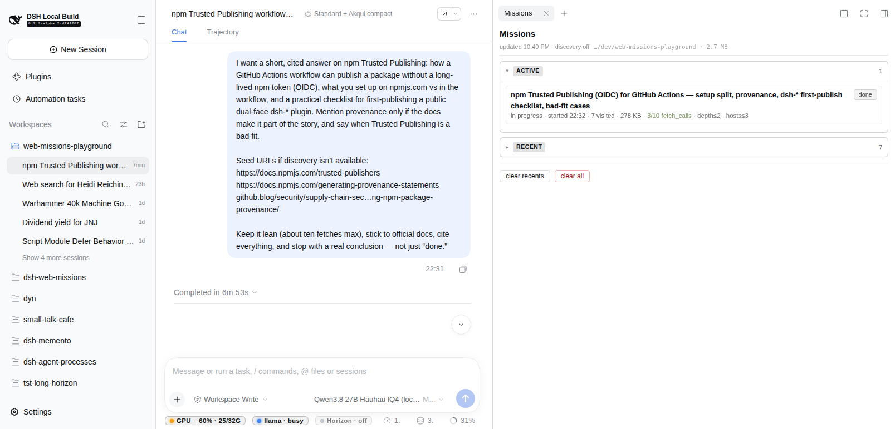
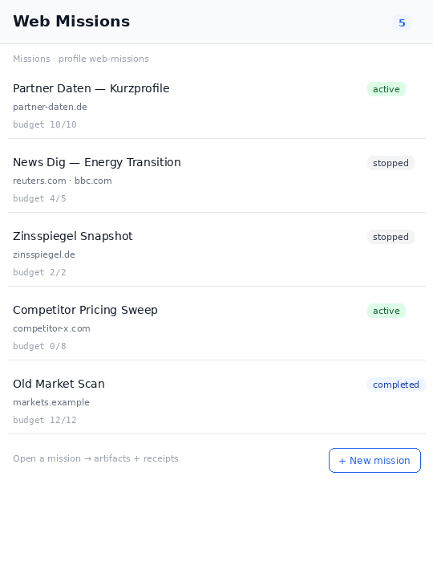
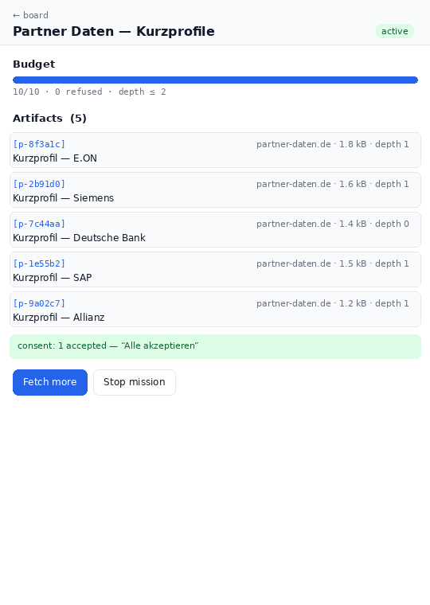
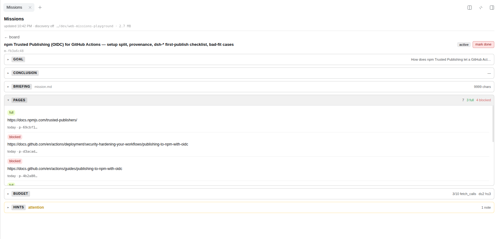

# dsh-web-missions

Persist-and-find **web research** for local coding agents in the **DeepSeek
Harness** web UI.

npm package and GitHub repo share the name **`dsh-web-missions`**
([`janpauldahlke/dsh-web-missions`](https://github.com/janpauldahlke/dsh-web-missions)).

A **mission** is a small, budgeted web-fetch unit: the agent pulls a handful of
pages through a local `browser39` headless browser, every fetched page becomes
a durable artifact in a per-project store, and the agent **finds it back**
lexically later — across sessions. Budget, an egress allowlist, and a depth
fence bound the work; cookie-banner consent is handled deterministically by the
host, not the model. No cloud search, no embeddings, no vector store, no LLM
calls inside the plugin.

**Related plugins** (same dual-face `dsh.bundle` shape for the web rightbar):

| Plugin | Repo |
| --- | --- |
| Bounded-file agent memory | [`dsh-memento`](https://github.com/janpauldahlke/dsh-memento) |
| Long-horizon task status | [`dsh-local-long-horizon`](https://github.com/janpauldahlke/dsh-local-long-horizon) |
| Process & port lifecycle | [`dsh-agent-processes`](https://github.com/janpauldahlke/dsh-agent-processes) |
| NVIDIA GPU util / VRAM / power | [`dsh-gpu-monitor-nvml`](https://github.com/janpauldahlke/dsh-gpu-monitor-nvml) |
| Local LLM endpoint / slot health | [`dsh-slot-health`](https://github.com/janpauldahlke/dsh-local-endpoint-health) |
| Local web discovery (SearXNG / browser39 search) | [`dsh-web-discovery`](https://github.com/janpauldahlke/dsh-web-discovery) |

This package: [`dsh-web-missions`](https://www.npmjs.com/package/dsh-web-missions)
· source [`janpauldahlke/dsh-web-missions`](https://github.com/janpauldahlke/dsh-web-missions).

Verified against DeepSeek Harness **`0.2.1-alpha.2`** (`dsh web`).

---

## Requirements

- DeepSeek Harness web profile (`dsh web`).
- Node.js **≥ 20** to build.
- `@aquintanar/browser39` **2.0.0** (the only runtime dep) — a local headless
  browser whose platform binary ships as an optional dependency, so no system
  Chrome is required.
- Happy-path companion **`dsh-web-discovery`** (same profile, curated
  version — see that package’s `HANDOVER.md`). Provides `discovery_search`
  (SearXNG and/or `browser39 search`) as the **opener** ritual step. Without
  it, seed URLs + `mission_fetch` still work (`no_engine` is supported); do
  not expect `discovery_search` in the tool list. Not folded into this package.

---

## Screenshots

Light theme, matching the DSH default. Full-width shots (stacked — narrow
rightbar crops badly in two-column tables).

**In the rightbar** (chat + Missions pane):



**Board** (recents):



**Detail** (conclusion delivered):



**Pages ledger** (full / blocked color grammar):



---

## What you see

- **Web Missions rightbar** — board (active XOR recent) and per-mission detail
  as collapsible cards (goal → conclusion → briefing → pages → budget → hints).
- **Color grammar** — green = conclusion delivered / page **full**; amber =
  thin or hints attention; red = blocked / budget exhausted. Status pills stay
  grey (lifecycle, not quality).
- **Budget** — remaining/max `fetch_calls` plus depth/host fence in the card
  preview; refusal gates (allowlist, depth, host-breadth) cost zero.
- **Consent note** — when a cookie banner was auto-accepted, the receipt says
  so.

---

## Install

### From npm (recommended)

```sh
dsh plugin --profile web add dsh-web-missions
# restart dsh web (or rely on live patch reload), then hard-refresh the browser
```

### From GitHub

```sh
dsh plugin --profile web add github:janpauldahlke/dsh-web-missions
```

### From a git checkout (developers)

```sh
git clone https://github.com/janpauldahlke/dsh-web-missions.git
cd dsh-web-missions
npm install && npm run build
dsh plugin --profile web add "$(pwd)"
```

Restart (or boot) `dsh web` so the host + client faces load:

```sh
env -u DSH_WEB_URL -u DSH_SHELL -u DSH_SESSION_ID dsh web --no-open
```

Uninstall:

```sh
dsh plugin --profile web remove dsh-web-missions
# restart the web instance that had the plugin
```

---

## Agent tools

| Tool | Purpose |
| --- | --- |
| `mission_start` | Start a mission — store dir + `mission.md` + recents row. Optional seed URLs (depth 0). |
| `mission_list` | Board — active + recents. |
| `mission_status` | Manifest + visited ledger (+ optional `discovery` if the companion recorded candidates). |
| `mission_fetch` | Fetch via local `browser39` (cache hits free; `force` re-fetches). |
| `mission_find` | Lexical search over **stored** pages only — never fetches. |
| `mission_read` | Read one stored chunk (verbatim text + quality). Zero budget; text is **untrusted**. |
| `mission_verify` | Claim check: citations resolve to `full` artifacts; numbers appear in cited pages. |
| `mission_stop` | Stop the mission and run the same claim check. |

Ritual: **fetch → find → read → note → verify → stop**. Every fetch is a
receipted artifact (`p-…`) with `page_quality`, `chunk_count`, `next_step_hint`,
consent flags, and budget. Blocked pages are stored too.

---

## Egress, budget + depth

- **Allowlist** — **off by default**. When `"allowlist": "on"` in
  `<cwd>/.dsh/web-missions/config.json`, `<cwd>/.dsh/allowlist.txt` gates
  egress (one pattern per line, `#` comments; `**` = allow all). A missing
  file is seeded with a template; empty patterns → `allowlist_empty`; a miss
  → `allowlist_denied` (message names the off-switch). Cache hits are not
  re-gated.
- **Budget** — each mission has a `used/total` fetch budget. Cache hits and
  refusal gates cost zero.
- **Depth fence** — `maxDepth` (default **2**) + `maxDiscoveredHosts`
  (default **3**) bound crawl breadth/depth.

Config knobs: `<cwd>/.dsh/web-missions/config.json` (overrides optional
`~/.dsh/web-missions/config.json`) — `allowlist`, `snippetWindow`,
`previewChars`, `readChars`, `sampleLinks`, `findLimit`, `maxDepth`,
`maxDiscoveredHosts`, `defaultFetchBudget`, `numberFormatCheck`, …

---

## Privacy

- **Local only** — fetches run through a local `browser39` headless browser and
  are rendered to markdown locally. No search engine, no cloud API.
- **Scoped sessions** — `browser39` sessions live under
  `~/.dsh/browser39/sessions/<host>/` (persisted, so an accepted consent
  survives a refetch); the mission store lives under `<cwd>/.dsh/web-missions/`.
- **Consent is deterministic** — cookie-banner acceptance is host code behind
  the receipt (not a model judgment). Shipped vocabulary:
  `assets/consent_profiles.toml` (`generic` labels for every host; optional
  `[[hosts]]` only to prioritize site-unique labels). Per-project override:
  copy that file to `<cwd>/.dsh/web-missions/consent_profiles.toml` (replaces
  wholesale — do not grow an endless host list in the package).
- **No LLM calls, no embeddings, no vector store** inside the plugin.

---

## Surfaces

| Surface | Path / name |
| --- | --- |
| Mission store | `<cwd>/.dsh/web-missions/<id>/` (`manifest.json`, `mission.md`, `artifacts/`, `receipts.json`, `links.json`, `config.json`) |
| Egress allowlist | `<cwd>/.dsh/allowlist.txt` |
| `browser39` sessions | `~/.dsh/browser39/sessions/<host>/` |
| Consent profiles | `assets/consent_profiles.toml` (`generic` + optional hosts; cwd override replaces wholesale) |
| HTTP | `GET /api/web-missions/health` · `/missions` · `/missions/:id` · `/sessions` · `POST …/stop` · `…/recents/clear` · `…/clear-all` |
| UI | Rightbar **Web Missions** (board + detail) |

---

## Design in five lines

1. **A mission is a budgeted fetch unit** — seed URLs + a `used/total` budget;
   the store is the unit of persistence.
2. **Every fetch is a receipted artifact** — `chars`, `page_quality`,
   `consent_*`, budget — so claims stay verifiable and dead URLs are known.
3. **Find is read-only** — `mission_find` ranks the store lexically (no
   embeddings, no vectors) and never triggers a fetch.
4. **Three fences, zero-cost refusals** — budget, egress allowlist, and a
   depth / host-breadth fence bound the work without wasting budget.
5. **Consent is host code** — deterministic cookie-banner handling behind the
   receipt, never a model judgment.

Deliberately absent: cloud search, embeddings, vector stores, and LLM calls
inside the plugin.

---

## Architecture

Dual-face package (same bar as the other web rightbar plugins):

- **Host** (`lib/index.js`, ESM) — mission store, `browser39` fetch, consent
  tactic, lexical find, egress / budget / depth fences, HTTP, tools.
- **Client** (`lib/client.js`, CJS ModuleLoader factory) — the Web Missions
  rightbar (board + detail).
- **Glue** — `cordis.patch.yml` + `dsh.bundle` / `dsh.client` in `package.json`.
- **Build** — `build.mjs` calls `dsh-build-tools` (`buildDshPlugin()`); `lib/`
  is tracked so `prepare` can fall back when the toolchain is unavailable.

The `@aquintanar/browser39` runtime dep carries the platform headless-browser
binary as an optional dependency; `BROWSER39_BIN` overrides the binary path.

---

## Develop / test

Hermetic checks live under `test/` (same bar as other `dsh-*` plugins /
`dsh-build-tools`). Operator boot scripts are local-only under `agent/scripts/`
(gitignored).

```sh
npm run build
npm run smoke              # tool-face + untrusted + pane + r4 + conclusion-md
npm run smoke:consent      # consent profiles + tactic
npm run smoke:allowlist    # egress allowlist
```

---

## License

MIT — see [`LICENSE`](./LICENSE).
